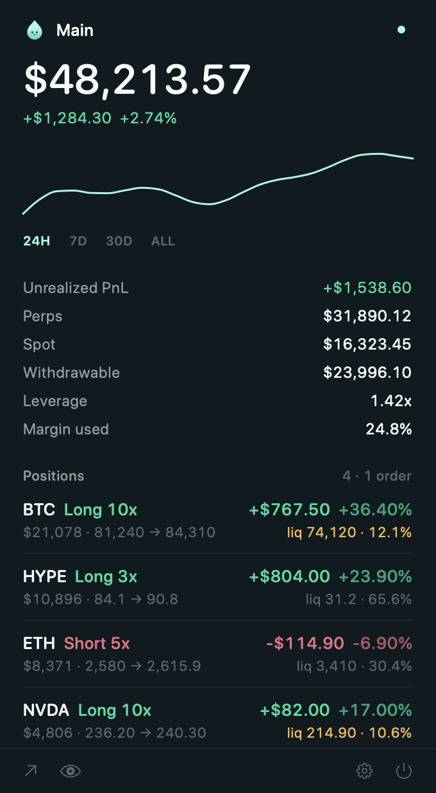

<p align="center">
  
</p>

<h1 align="center">HyperMac</h1>

<p align="center">
  Your <a href="https://hyperliquid.xyz">Hyperliquid</a> account, live in the macOS menu bar.<br>
  Read-only · public address only · no keys, ever.
</p>

<p align="center">
  
</p>

## Features

- **Total value** with 24H / 7D / 30D / ALL chart (hover to scrub) — the same figure Hyperliquid shows
- **Perp positions** — side, leverage, PnL, ROE, entry → mark, liquidation price and distance
- Includes **HIP-3 markets** (e.g. `xyz:NVDA`), unified / portfolio-margin accounts, spot, staked HYPE, vaults and HyperEVM HYPE
- **Liquidation warning** — the menu bar icon turns into ⚠ when any position is within 10% of liquidation
- Multiple wallets, privacy mode (hide balances), launch at login
- Native SwiftUI, ~3 MB universal app, no dependencies, no analytics

## Safety

HyperMac only ever asks for a **public address** (`0x…`). It never asks for, stores, or needs a
private key or seed phrase, and it cannot sign transactions or move funds. It only calls Hyperliquid's
public read-only endpoints (`api.hyperliquid.xyz/info`, `rpc.hyperliquid.xyz/evm`). Wallets are stored
locally in macOS preferences.

> If anyone — or any app claiming to be HyperMac — asks for your private key or seed phrase, it's a scam.

## Install

1. Download `HyperMac.zip` from [Releases](../../releases), unzip, and drag **HyperMac** into Applications.
2. The app is open source but not notarized by Apple, so the first time: right-click → **Open** → **Open**
   (or run `xattr -dr com.apple.quarantine /Applications/HyperMac.app`).
3. Click the droplet in your menu bar and paste your public address.

Requires macOS 14 Sonoma or later (Apple Silicon or Intel).

## Build from source

```sh
git clone https://github.com/lynnmeanslight/HyperMac.git
cd HyperMac
scripts/build.sh --install     # builds a universal app into ~/Applications and launches it
```

Only the Xcode command line tools are needed (`xcode-select --install`) — no Xcode project.

| Path | What |
| --- | --- |
| `Sources/HyperMac/App.swift` | Menu bar entry point and label |
| `Sources/HyperMac/Hyperliquid.swift` | Read-only API client; builds a snapshot of an address |
| `Sources/HyperMac/Store.swift` | Wallets, refresh timer, state |
| `Sources/HyperMac/UI.swift` | The panel |
| `Sources/HyperMac/Models.swift` | Models and number formatting |
| `scripts/make-icons.swift` | Draws the logo and regenerates every icon (`swift scripts/make-icons.swift`) |

Releases: push a tag like `v1.0.0` and GitHub Actions builds and attaches `HyperMac.zip`.

## Notes

- For unified / portfolio-margin accounts, spot also backs perps, so *Perps + Spot* can exceed the total.
- Funding is shown since the position was opened (+ means you earned it).
- Liquidation distance = |mark − liq| / mark.

## Disclaimer

Not affiliated with Hyperliquid. Data is provided as-is and may be delayed or wrong — always check
the official app before making trading decisions.

## License

[MIT](LICENSE)
